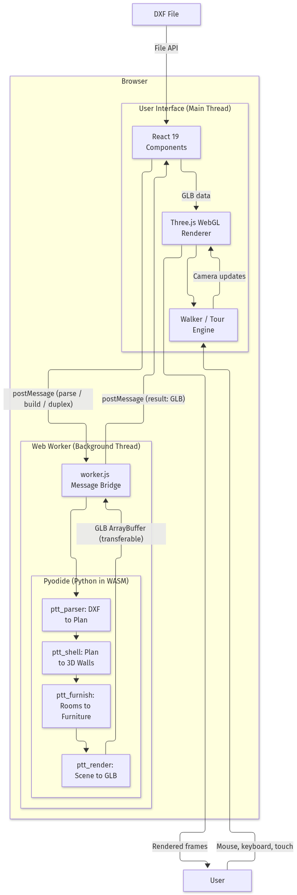
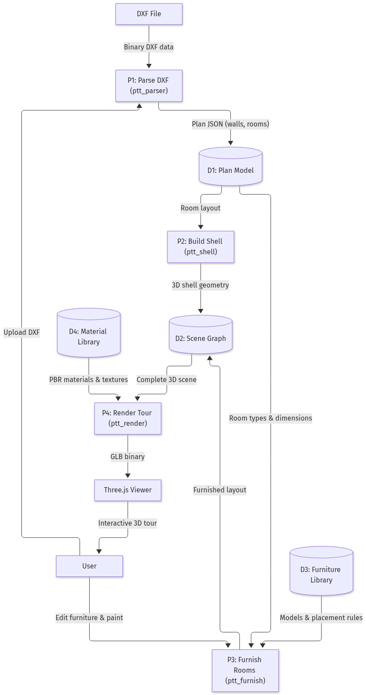
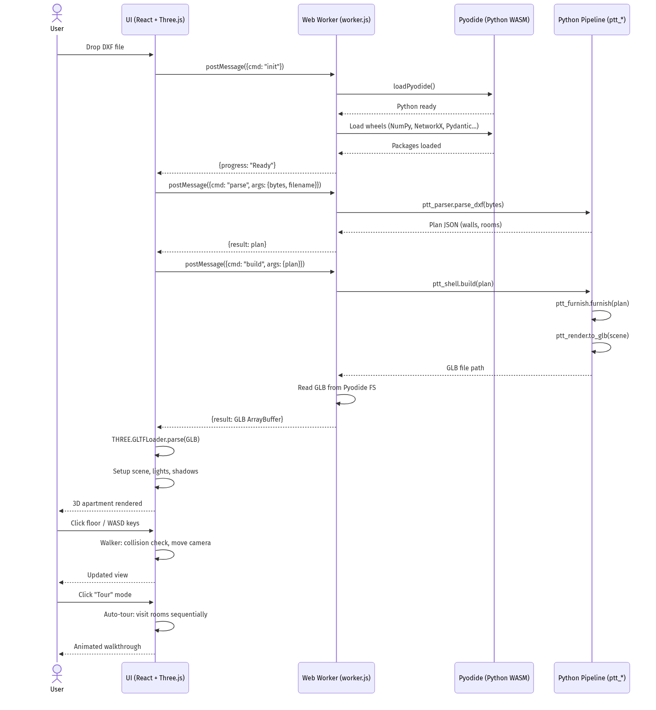

# Architecture

## System Overview

VisualEyes runs entirely inside the user's browser. There is no backend server — all DXF parsing, room detection, auto-furnishing, and 3D GLB generation happen client-side using Python compiled to WebAssembly (Pyodide) inside a Web Worker, paired with Three.js on the main thread.

## High-Level Architecture

## Component Details

### 1. User Interface (`index.html` + `app.js`)

Built with React 19 and Three.js, featuring a glass-morphism overlay UI:

- **Upload Modal** — Drag-and-drop or file picker for single-floor or duplex (Ground + Upper) `.dxf` files
- **3D Viewer (`#view`)** — Full-viewport Three.js WebGL canvas with shadow mapping and environment lighting (`env/sky.hdr`)
- **Room Strip (`#strip`)** — Scrollable room cards with thumbnails and area metrics for one-click navigation
- **Control Island (`#island`)** — Mode switcher for Walk, Orbit, Plan, and Auto-Tour
- **Side Panel** — Interactive furniture library, selection gizmos (move/rotate/delete), and custom wall paint color picker
- **Level Selector (`#levels`)** — Floor switcher for duplex projects

### 2. Web Worker (`worker.js`)

Isolates the heavy Pyodide WASM runtime from the UI thread:

- **Message Protocol**: `{id, cmd, args}` -> `{id, ok, result}` (or `{id, ok: false, error}`)
- **Commands**:
  - `init`: Boots Pyodide, loads WASM wheels (`numpy`, `networkx`, `pydantic`, `pyparsing`, `fonttools`), unpacks `py.zip`, and warms pipeline imports
  - `parse`: Runs `ptt_live.parse_dxf` on raw DXF bytes
  - `edit`: Runs `ptt_live.edit_plan` with user plan corrections
  - `build`: Runs `ptt_live.build_tour` and transfers the resulting `.glb` `ArrayBuffer`
  - `duplex`: Runs `ptt_live.build_duplex` for stacked multi-floor tours
- **Progress Streaming**: Emits `{progress: {step, done, total}}` during initialization

### 3. Python Pipeline (`ptt_*`)

| Module | Responsibility |
|--------|----------------|
| `ptt_parser` | Extracts DXF entities (`LINE`, `ARC`, `LWPOLYLINE`, `INSERT`), constructs wall topology graph via NetworkX, detects & classifies rooms |
| `ptt_shell` | Extrudes 2D wall segments into 3D meshes with parametric door/window cutouts, floors, and ceilings |
| `ptt_furnish` | Places furniture items per room type using spatial constraints, door-swing keepout zones, and proportional scaling |
| `ptt_render` | Assembles the final glTF/GLB binary with PBR materials, textures, and camera/tour metadata |

### 4. Classic Plan Editor (`classic.html`)

A standalone 2D drafting-table editor allowing users to inspect and correct wall geometry or room labels before 3D tour generation.

## Data Flow

## End-to-End Sequence

