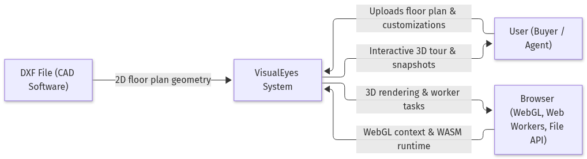
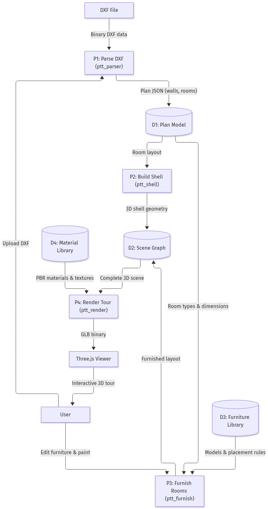
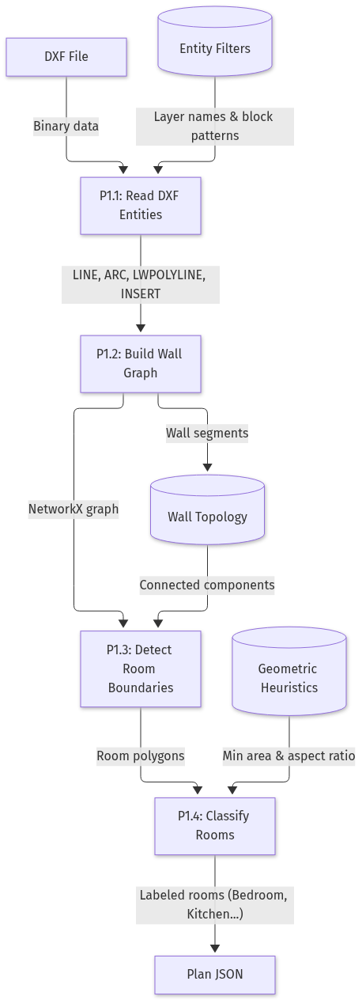
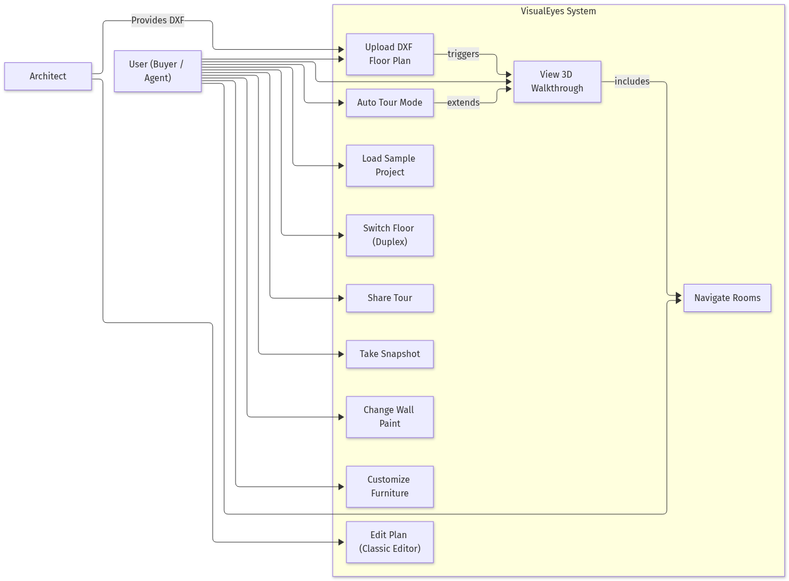
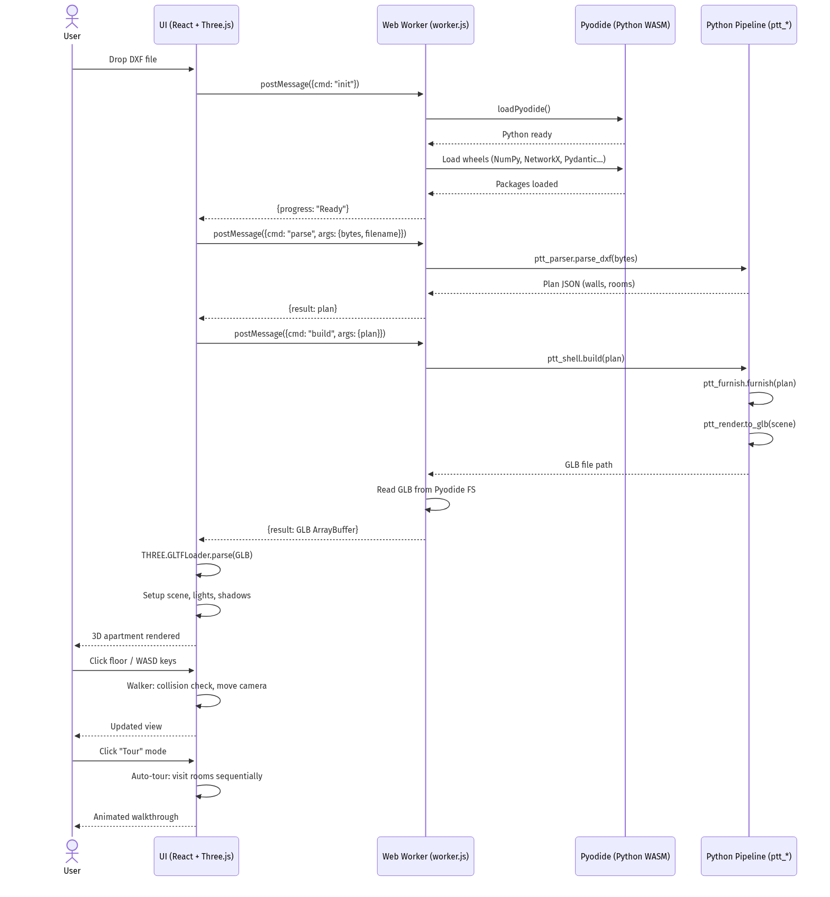

# Data Flow Diagrams & System Models

## Context Diagram (Level 0 DFD)

The context diagram illustrates VisualEyes as a single system boundary interacting with its external entities.

**External Entities:**

- **User** — Uploads DXF floor plans, customizes furniture/paint, and navigates the 3D tour
- **DXF File** — Input 2D CAD floor plan exported from architectural software
- **Browser** — Provides WebGL context, Web Workers, and the File API

---

## Level 1 DFD

The Level 1 DFD decomposes VisualEyes into its four core processing stages and supporting data stores.

**Processes:**

1. **P1: Parse DXF (`ptt_parser`)** — Reads binary DXF data, extracts geometric entities, and identifies rooms
2. **P2: Build Shell (`ptt_shell`)** — Extrudes 3D wall, floor, and ceiling geometry from the plan model
3. **P3: Furnish Rooms (`ptt_furnish`)** — Places furniture based on room classification and spatial constraints
4. **P4: Render Tour (`ptt_render`)** — Assembles the GLB 3D scene with PBR materials and camera tour paths

**Data Stores:**

- **D1: Plan Model** — Intermediate JSON representation of walls, openings, and rooms
- **D2: Scene Graph** — Combined 3D shell and furniture geometry
- **D3: Furniture Library** — Catalog of furniture items, dimensions, and placement rules
- **D4: Material Library** — Surface materials, textures, and paint color palettes

---

## Level 2 DFD — Parser Subsystem

The Level 2 DFD expands **P1 (Parse DXF)** into its internal sub-processes.

**Sub-processes:**

1. **P1.1: Read DXF Entities** — Extracts `LINE`, `ARC`, `LWPOLYLINE`, and `INSERT` entities using layer/block filters
2. **P1.2: Build Wall Graph** — Connects line segments into a topological wall graph using NetworkX
3. **P1.3: Detect Room Boundaries** — Identifies closed polygons representing individual rooms
4. **P1.4: Classify Rooms** — Labels rooms (`BEDROOM`, `KITCHEN`, `BATHROOM`, `LIVING`, etc.) using area, aspect ratio, and openings

---

## Use Case Diagram

---

## Sequence Diagram

**End-to-End Execution Flow:**

1. User drops a `.dxf` file in the UI
2. UI sends `init` (first run) and `parse` commands to `worker.js`
3. Web Worker boots Pyodide, loads WASM wheels, and runs `ptt_parser`
4. UI receives the parsed Plan JSON and triggers `build`
5. Pipeline executes `ptt_shell` -> `ptt_furnish` -> `ptt_render` to produce a `.glb` file
6. Worker reads the `.glb` from Pyodide FS and transfers the `ArrayBuffer` to the main thread
7. Three.js parses the GLB with `GLTFLoader` and renders the interactive 3D tour
